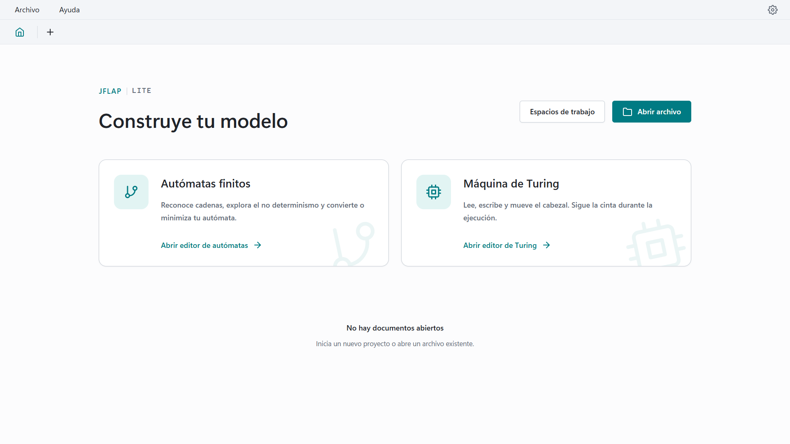
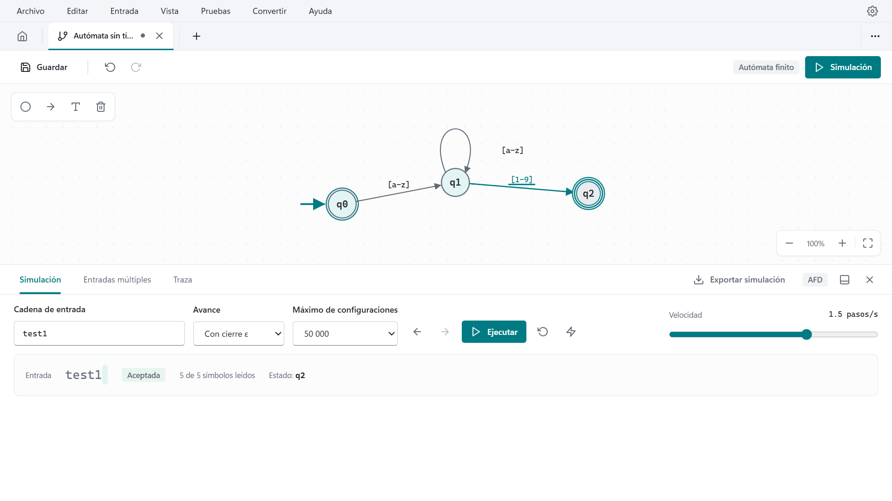
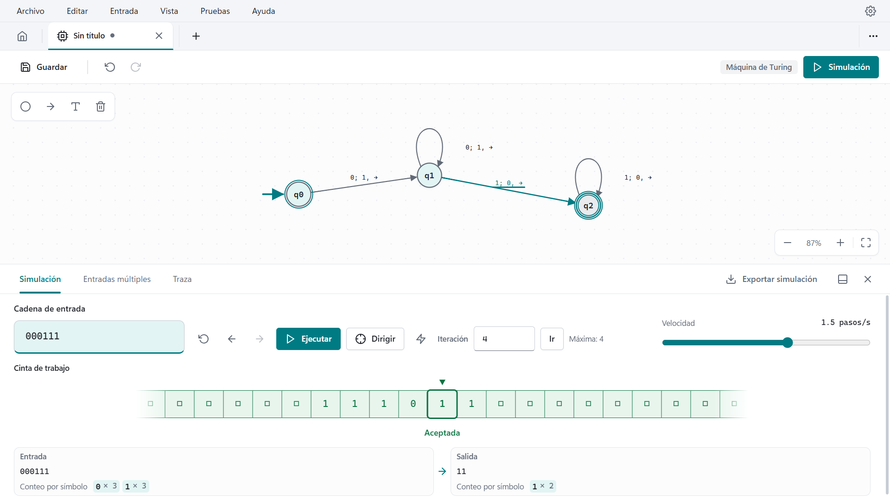

<p align="center">
  
</p>

<h1 align="center">JFLAP Lite</h1>

<p align="center">
  <strong>Diseña autómatas y simula su ejecución paso a paso.</strong><br />
  Editor de autómatas finitos y máquinas de Turing de una cinta para Windows y macOS.<br />
</p>

<p align="center">
  <a href="https://github.com/jtorressmx/jflap-lite/releases"></a>
  <a href="https://github.com/jtorressmx"></a>
</p>

<p align="center">
  <strong>Windows x64</strong> · <a href="https://github.com/jtorressmx/jflap-lite/releases/latest/download/JFLAP-Lite-Windows-Setup-x64.exe">Instalador</a>
  · <a href="https://github.com/jtorressmx/jflap-lite/releases/latest/download/JFLAP-Lite-Windows-x64.exe">Portable</a><br />
  <strong>macOS</strong> · <a href="https://github.com/jtorressmx/jflap-lite/releases/latest/download/JFLAP-Lite-macOS-arm64.dmg">Apple Silicon</a>
  · <a href="https://github.com/jtorressmx/jflap-lite/releases/latest/download/JFLAP-Lite-macOS-x64.dmg">Intel</a>
</p>



|                                               Simulación de autómatas finitos                                                |                                                     Simulación de Turing                                                      |
| :--------------------------------------------------------------------------------------------------------------------------: | :---------------------------------------------------------------------------------------------------------------------------: |
| [](assets/afd.png) | [](assets/turing.png) |

## Desarrollo

Requiere Node.js 24 o posterior.

```sh
npm ci
npm run dev
```

## Créditos

Basado en JFLAP 7.1, de Susan H. Rodger y colaboradores de Duke University. Consulta la [licencia](LICENSE).
